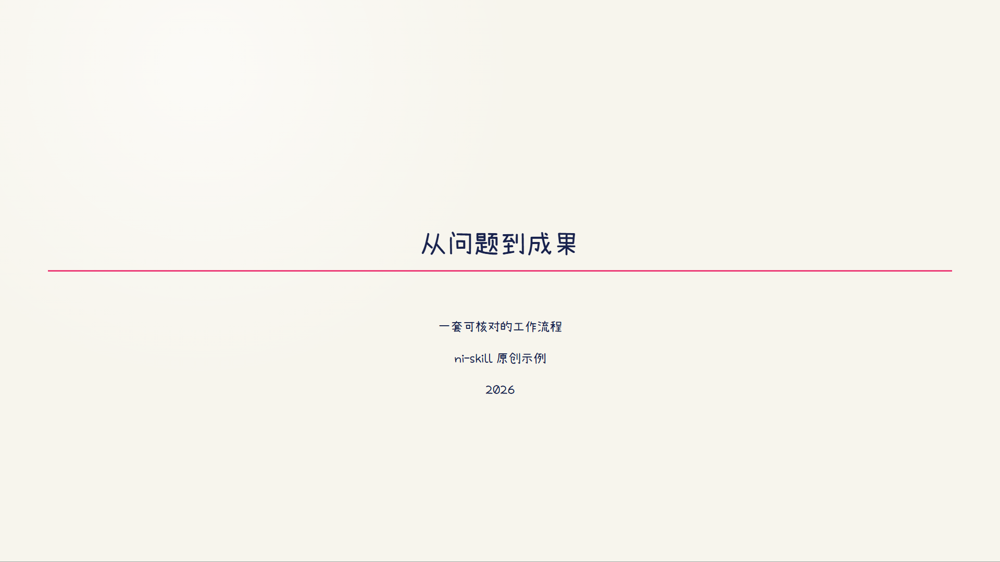
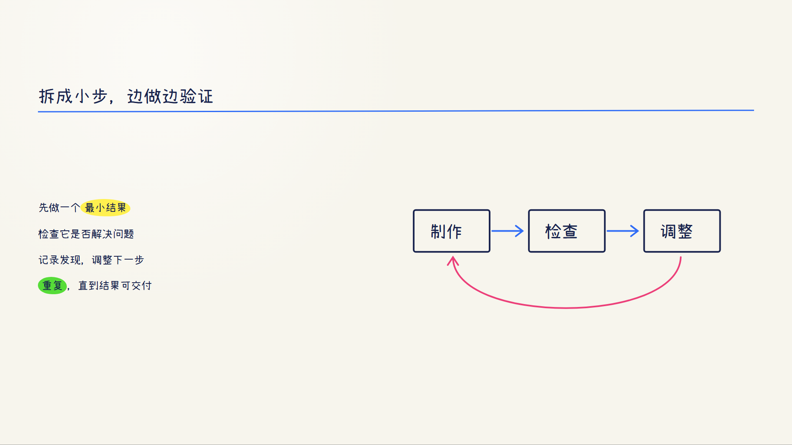

# ni-wanghong-handwritten-style

根据用户指令，把文章、讲稿或技术主题制作成王虹学术手写风 PPT，或将同一套 HTML 制作为无声动画视频。

- **PPT 模式：**生成 16:9 HTML 幻灯片、逐页 PNG 和默认的时间轴版 HTML。
- **视频模式：**直接渲染 HTML DOM，输出 1920×1080、30fps、H.264、yuv420p、无音轨 MP4 与封面。
- **两种格式：**共享同一份 HTML；用户没有说清格式且上下文无法判断时先询问。

## 文件

- PPT 规则：references/ppt-workflow.md
- 视频规则：references/video-workflow.md
- HTML 模板：templates/deck.html
- 字体、动画和标注资源：assets/
- HTML 结构检查：scripts/check_deck.py
- 时间轴版构建：scripts/build_timeline.py
- PPT 逐页 PNG 导出：scripts/render.sh
- 视频渲染与媒体检查：scripts/render_html_video.sh
- 原创 PPT 示例：examples/ni-demo/
- 视频样片：examples/handwritten-html-motion-demo/

## 依赖

PPT 导出需要 Chrome/Chromium 和 Python 3。视频渲染另需 Node.js、npm、ffmpeg、ffprobe 和 Puppeteer Core。Windows 可在 Git Bash 中运行脚本。默认优先使用本机或显式指定的 HanziPen SC；没有时使用随包的小赖字体。小赖字体与 HanziPen 字形不同，如用户明确要求 HanziPen，则需提供该字体文件，不能静默替代。

`assets/fonts/Xiaolai-Regular.ttf` 来自 [lxgw/kose-font](https://github.com/lxgw/kose-font) v3.126，按 SIL Open Font License 1.1 分发，许可见同目录 `Xiaolai-OFL.txt`。可通过字体参数或 `WANGHONG_FONT_PATH` 指定字体；渲染时检查实际字形。

## 来源与许可

此技能合并自 [tjxj/z-skills](https://github.com/tjxj/z-skills) 中的 z-wanghong-handwritten-ppt 与 z-wanghong-handwritten-video，保留上游许可。随附样片由 ni-skill 重新制作。
